# USER FLOW Document

**Project:** GCTU StudentHostels
**Version:** 1.0
**Date:** October 2026
**Status:** Active
**Related:** PRD v1.0, MVP Scope v1.0

---

## 1. Overview

This document maps out all user journeys through the GCTU StudentHostels platform - the central hub aggregating all hostel platforms for GCTU students. It details interactions, decision points, and system responses for different user types.

## 2. User Types

| User Type | Access Level | Description |
|---|---|---|
| **Guest/Visitor** | Public | Unauthenticated user browsing hostels |
| **Student** | Authenticated | Registered student using the platform |
| **Admin** | Privileged | System administrator (planned) |

## 3. User Flows

### 3.1 Guest User Flows

#### Flow 1: Browse Hostels (Public)
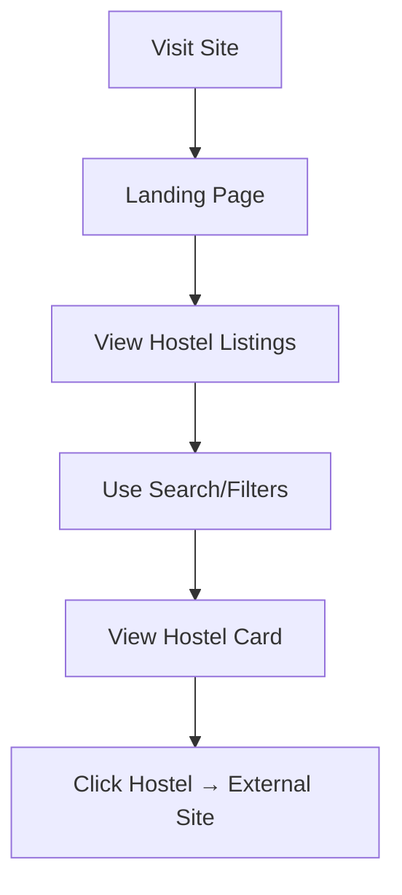

**Steps:**
1. **Entry**: User visits `https://student-hostels.netlify.app`
2. **Discovery**: Views hero section, statistics, hostel listings
3. **Search**: Can search by name/location or use filters (availability, budget, distance)
4. **Browse**: Scrolls through hostel cards with images, price, location
5. **Action**: Clicks "View/Book" → Redirected to official hostel website
6. **Exit**: Leaves platform to complete booking on hostel's site

#### Flow 2: Contact Form Submission
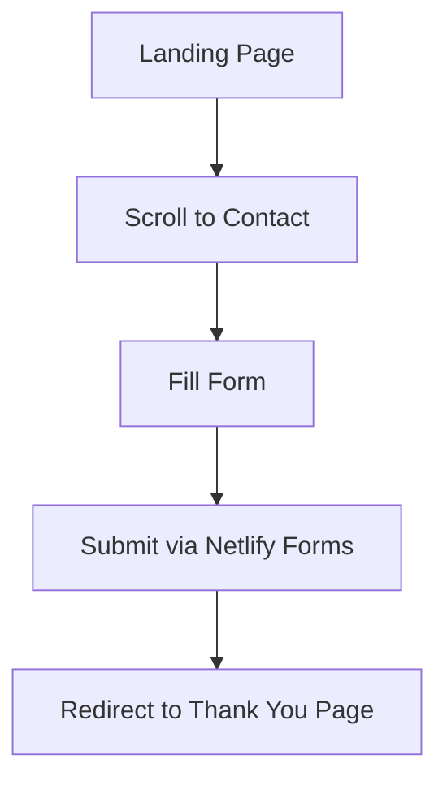

**Steps:**
1. Navigate to contact section
2. Fill name, email, message
3. Submit form (handled by Netlify)
4. Redirect to thank-you page

### 3.2 Student Registration Flow

#### Flow 3: New User Registration with OTP
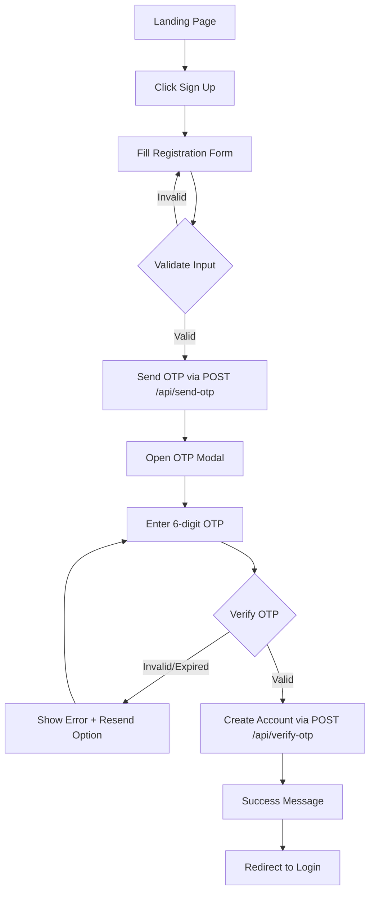

**Detailed Steps:**
1. **Initiation**: Click "Sign Up" from landing page or login page
2. **Form Input**: Enter fullName, username, email, password
3. **Client Validation**: Check password strength (8+ chars, uppercase, lowercase, number, special char)
4. **Submit**: POST to `/api/send-otp`
5. **Server Validation**: Check duplicates, generate 6-digit OTP, save to session, send email
6. **OTP Modal**: Display with masked email, 10-minute countdown timer
7. **Verification**: User enters OTP, POST to `/api/verify-otp`
8. **Account Creation**: Server validates OTP, creates User, clears session
9. **Success**: Show confirmation, redirect to login page

**Error Cases:**
- Duplicate username/email → Error message
- Weak password → Client-side validation error
- Invalid OTP → Error, allow retry
- Expired OTP → Error, offer resend
- Rate limited → Error after 10 attempts

### 3.3 Student Authentication Flow

#### Flow 4: User Login
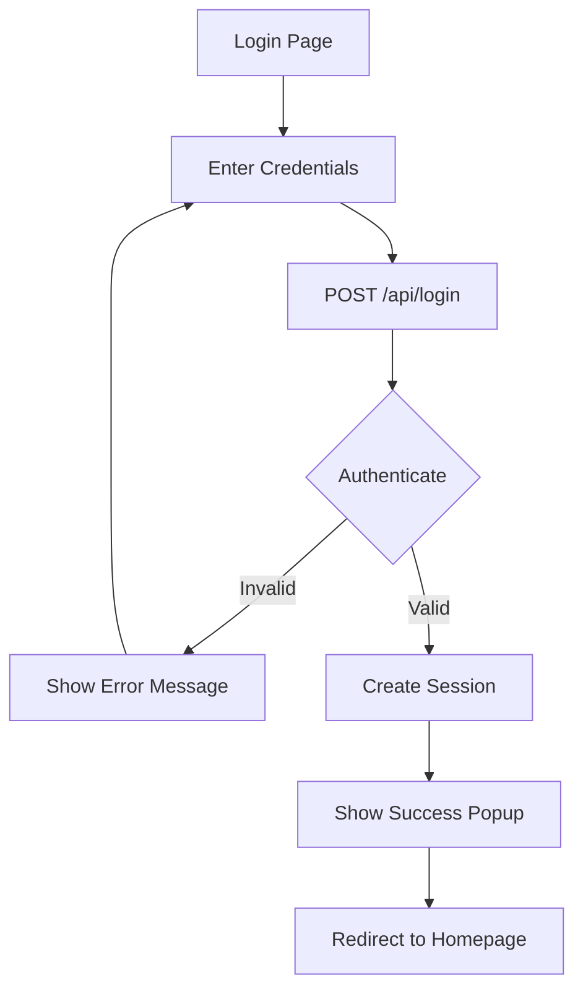

**Steps:**
1. Navigate to login page
2. Enter username and password
3. Submit form → POST `/api/login`
4. Server validates credentials with bcrypt
5. If valid: Create session with userId, set secure cookie
6. Show success popup (1.5s delay)
7. Redirect to `homepage.html`

**Error Cases:**
- Invalid credentials → Generic error (to be implemented)
- Rate limited → Too many attempts message
- Server error → Generic error message

#### Flow 5: User Logout
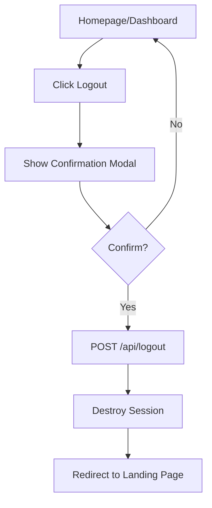

**Steps:**
1. Click logout button (in navbar/profile)
2. Confirmation modal appears
3. Confirm → POST `/api/logout`
4. Server destroys session
5. Redirect to landing page

### 3.4 Password Reset Flow

#### Flow 6: Forgot Password
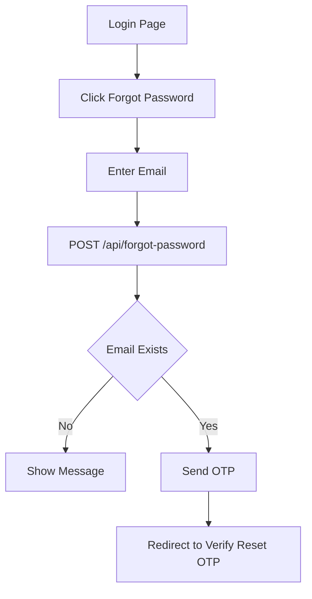

#### Flow 7: Verify Reset OTP
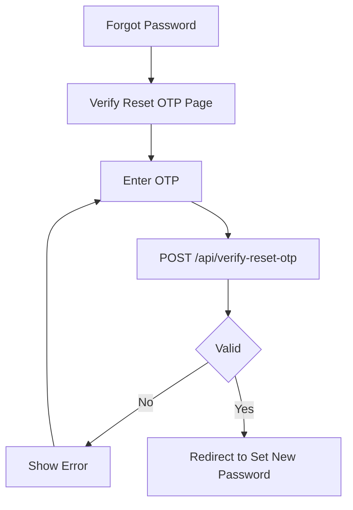

#### Flow 8: Set New Password
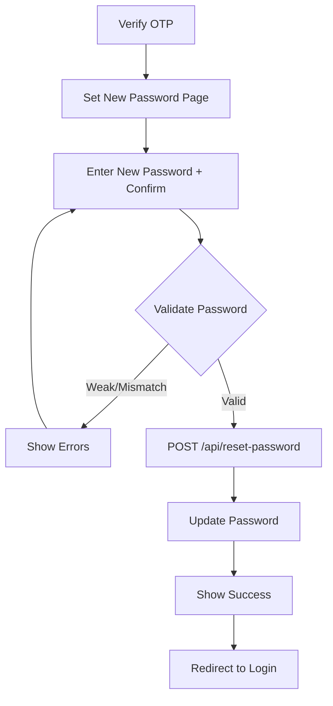

**Security Note:** Current implementation has bypass vulnerability - needs verification token enforcement.

### 3.5 Authenticated Student Flows

#### Flow 9: Access Authenticated Homepage
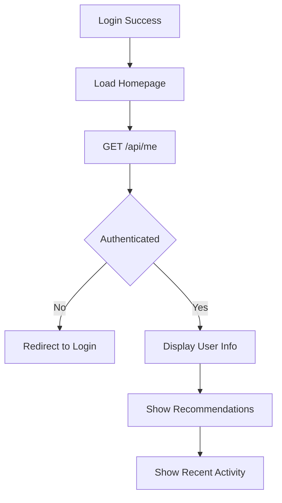

**Steps:**
1. After login, load `homepage.html`
2. JavaScript calls GET `/api/me`
3. If 401/unauthenticated → Redirect to login
4. If authenticated → Display user's fullName/initials
5. Show recommended hostels (currently mock data)
6. Show the user's persisted recent activity

#### Flow 10: Access Student Dashboard
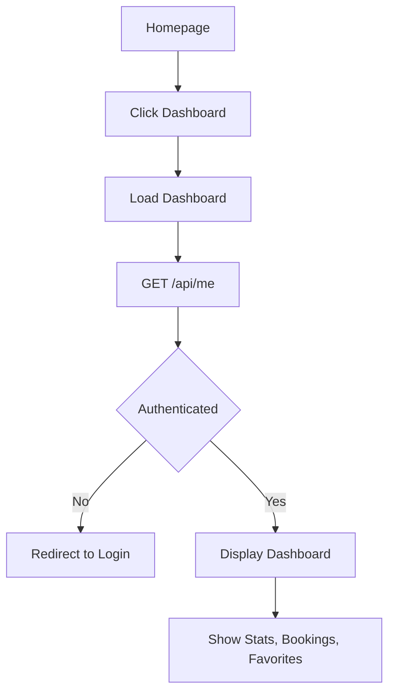

**Dashboard Sections:**
- Welcome section with avatar
- Stats cards (bookings count, saved count, spent amount)
- Current bookings
- Booking history
- Saved/favorite hostels
- Profile summary
- Recent activity
- Dark mode toggle

#### Flow 11: Manage Favorites (Planned)
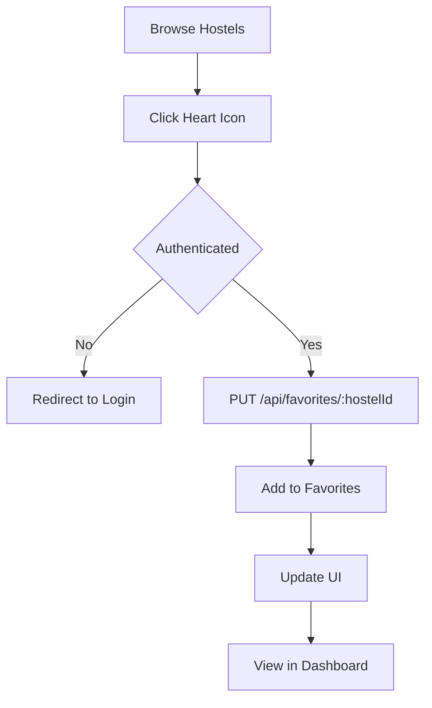

#### Flow 12: Express Booking Interest (Planned)
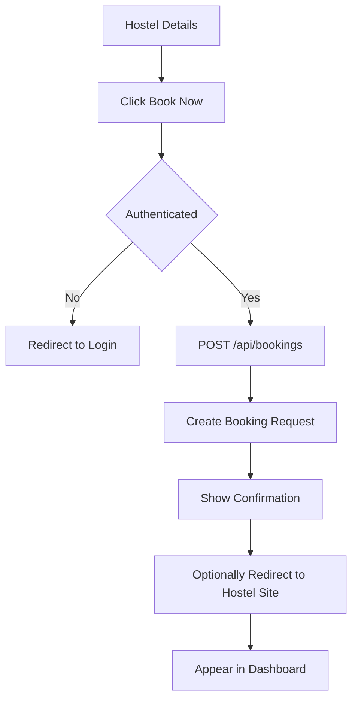

### 3.6 Admin Flows (Planned)

#### Flow 13: Admin Hostel Management
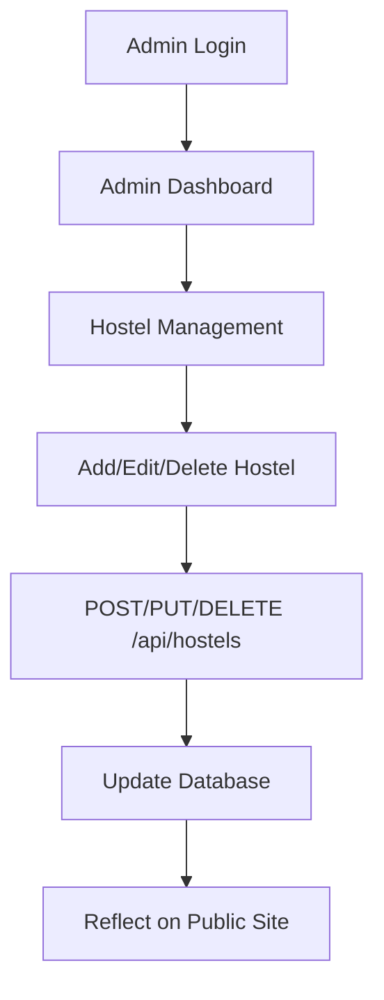

## 4. State Diagrams

### 4.1 Authentication State
```
[Guest] --signup--> [OTP Verification] --verify--> [Registered] --login--> [Authenticated]
[Authenticated] --logout--> [Guest]
[Guest] --forgot password--> [Reset OTP] --verify--> [New Password] --reset--> [Guest]
```

### 4.2 Session State
```
No Session → Login Success → Active Session (24h) → Expired/Logout → No Session
```

## 5. User Interface Touchpoints

| Page | Purpose | User Type | Key Actions |
|---|---|---|---|
| `index.html` | Landing/Discovery | Guest | Browse, search, filter, signup/login |
| `signup.html` | Registration | Guest | Create account |
| `login.html` | Authentication | Guest | Login, forgot password |
| `forgot-password.html` | Password reset request | Guest | Request reset |
| `verify-reset-otp.html` | Reset OTP verification | Guest | Verify OTP |
| `set-new-password.html` | New password setup | Guest | Set password |
| `homepage.html` | Student home | Student | View recommendations, navigate |
| `dashboard.html` | Student dashboard | Student | Manage profile, bookings, favorites |

## 6. Decision Points & Business Rules

### Authentication Rules
- Email must be unique and valid format
- Username must be unique
- Password must meet strength requirements
- OTP expires after 10 minutes
- Session expires after 24 hours
- Max 10 auth attempts per 15 minutes per IP

### Discovery Rules
- All hostels shown on public listing are visible to guests
- Search is case-insensitive (client-side currently)
- Filters are applied client-side
- Clicking hostel redirects to external official URL

### Booking Rules (Planned)
- Only authenticated users can express interest
- Each user can have multiple booking requests
- Booking request doesn't guarantee room availability
- User must be redirected to hostel's official site for actual booking

## 7. Error Handling Flows

| Scenario | User Experience | System Response |
|---|---|---|
| **Network Error** | Show error message | Catch fetch errors, display user-friendly message |
| **Unauthorized Access** | Redirect to login | Check session, redirect if not authenticated |
| **Rate Limited** | Show cooldown message | Display rate limit error from API |
| **Invalid OTP** | Show error, allow retry | Clear error on new input, offer resend |
| **Session Expired** | Redirect to login | API returns 401, redirect |
| **Server Error** | Generic error message | Global error handler, don't expose details |

## 8. Mobile User Flow Considerations
- Responsive design adapts to mobile screens
- Hamburger menu for navigation (if implemented)
- Touch-friendly buttons and cards
- OTP input optimized for mobile keyboards
- Forms stack vertically on small screens

## 9. Accessibility Considerations (Planned)
- Semantic HTML structure
- Alt text for images
- Keyboard navigation support
- ARIA labels where needed
- Sufficient color contrast
- Focus states visible

## 10. User Flow Metrics to Track
| Metric | Purpose | Target |
|---|---|---|
| **Registration Conversion** | Signup completion rate | >60% |
| **Login Success Rate** | Successful authentication | >95% |
| **Hostel Click-Through** | Interest in hostels | >40% |
| **Search Usage** | Filter adoption | >30% |
| **Dashboard Engagement** | Authenticated user activity | >50% monthly |

---

**Note:** Flows marked as "Planned" represent features not yet fully implemented but are part of the MVP roadmap or future phases.
